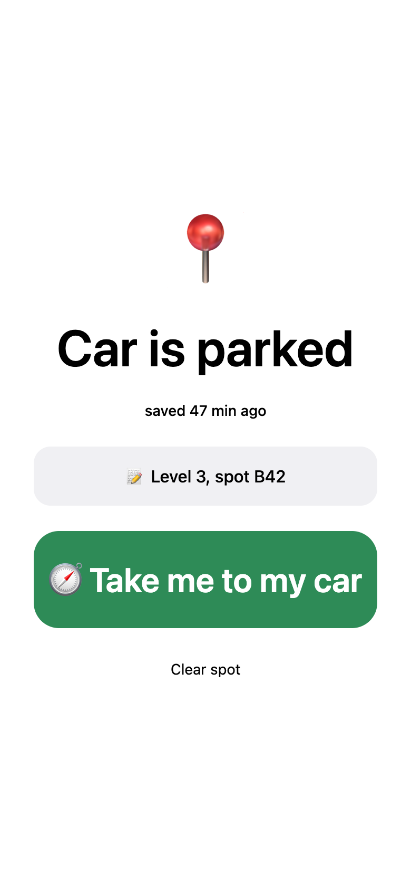
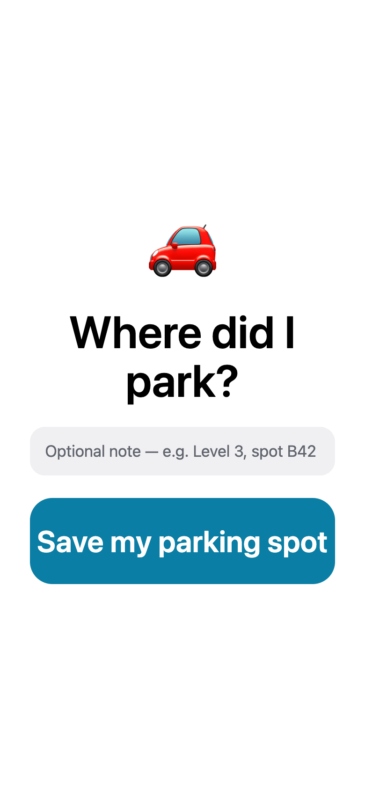
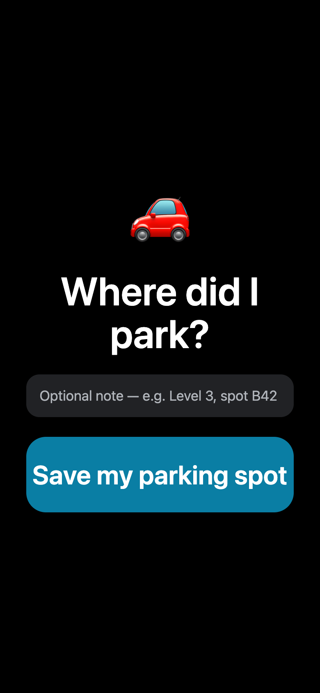
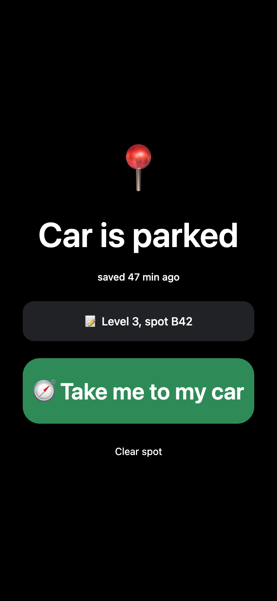

# Where's My Car

A one-screen phone app that remembers where you parked: one tap saves a GPS pin and an optional note, another
opens walking directions back to it. Runs in Expo Go on iPhone and Android, keeps the spot on the phone, and has
no account, server or analytics.



## Why

Apple Maps and Google Maps both have a parked-car feature, but it depends on CarPlay, Bluetooth or a setting you
forgot to turn on, and it lives three taps deep. Dedicated parking apps want an account and show ads. This is the
whole job in one screen: save, then walk back.

## What it does

- **One tap to save.** Asks for foreground location once, takes a high-accuracy fix, and stores latitude,
  longitude, time and note in AsyncStorage under `parking-spot`. Nothing leaves the phone.
- **A note for the hard part.** "Level 3, spot B42" for garages where GPS is the least useful thing you know.
- **Walking directions back.** Apple Maps (`dirflg=w`) on iOS, Google Maps walking directions everywhere else.
- **"Saved 47 min ago".** The time since parking refreshes every minute, handy for meters.
- **Light and dark.** Follows the system colour scheme.
- **Ships without an App Store build.** Runs in Expo Go; updates go out with EAS Update and apply on next open.

## Screenshots

| | |
|---|---|
|  |  |
| Empty | Saved |
|  |  |
| Dark | Dark |

*Screenshots are the web build in headless Chrome via `Tools/screenshots.mjs`, with a made-up spot and note,
nobody's actual location.*

## Quick start

Requirements: Node 20+, and Expo Go on a phone on the same Wi-Fi (or a browser).

```bash
git clone https://github.com/aaryann123/wheres-my-car && cd wheres-my-car
npm install
npm run dev        # expo start; scan the QR code with the iPhone Camera app or Expo Go on Android
```

Press `w` in the Expo terminal to open it in a browser instead; the browser asks for location the same way.

## Requirements

| | |
|---|---|
| Expo SDK | 54, pinned: the App Store's Expo Go runs SDK 54 only |
| React Native | 0.81, React 19.1, expo-router 6 |
| Phone | Expo Go on iOS or Android, location permission |
| Web | Any modern browser via react-native-web; directions open Google Maps |
| Publishing | Optional: an Expo account for `eas update` (see docs/BUILDING.md) |

Install new packages with `npx expo install <pkg>`, not `npm install`, so versions stay on SDK 54.

## How it's organised

```
src/app/index.tsx        the whole app: save, show, navigate, clear
src/app/_layout.tsx      a headerless Stack with light/dark navigation theme
src/components/          ThemedText, ThemedView
src/constants/theme.ts   colours, spacing, fonts
app.json                 Expo config (SDK 54 runtime policy)
app.config.js            adds your EAS owner / project id from env or expo.local.json
Tools/screenshots.mjs    web export + headless Chrome screenshots
```

[docs/ARCHITECTURE.md](docs/ARCHITECTURE.md) explains the choices; [docs/BUILDING.md](docs/BUILDING.md) covers
running, publishing and screenshots.

## Contributing

Pull requests are welcome.

- `npx tsc --noEmit` is the fast check; then open it in Expo Go or the browser.
- Keep the SDK at 54 until Expo Go in the App Store moves on.
- Screenshots use the seeded spot in `Tools/screenshots.mjs`, never a real location.
- Good first projects: a photo of the spot, a meter timer with a notification, several saved spots.

## Credits and licence

Where's My Car is MIT licensed, see [LICENSE](LICENSE).

- Started from [create-expo-app](https://github.com/expo/expo)'s default template (MIT, 650 Industries); the
  themed components and app icons come from it.
- Apple Maps and Google Maps are trademarks of their owners; the app only opens their public direction URLs.
